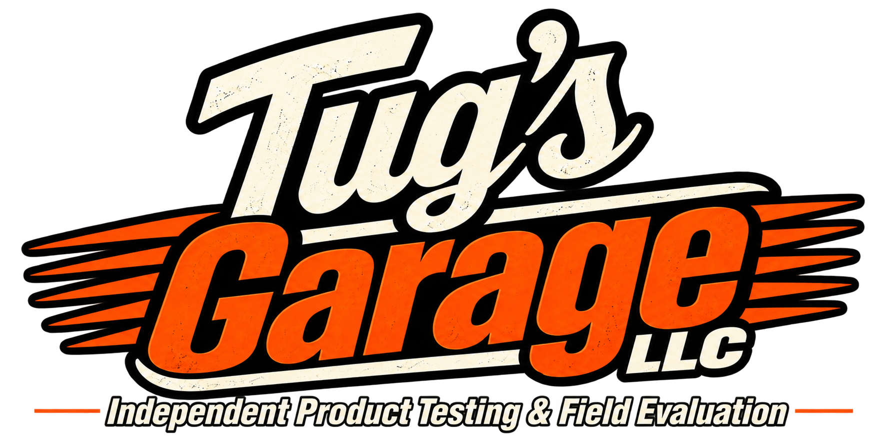

# Tug's Garage LLC

**Independent Product Testing & Field Evaluation**

**Real-world testing. Practical electrical experience. Useful manufacturer feedback.**

Tug's Garage LLC works with manufacturers to evaluate products in actual operating environments. We focus on how equipment performs, integrates, and holds up in everyday use—not just what a product claims on the box.

Our work combines hands-on product evaluation, practical electrical measurements where appropriate, usability and reliability observations, and clear documentation of findings and limitations.

**[Explore Professional Evaluation Services](professional-services.md)** · **[Discuss an Evaluation](mailto:tugsgarage@gmail.com)**

## What We Evaluate

- **Smart-home and connected devices:** Zigbee, Matter, Wi-Fi, Home Assistant integrations, sensors, smart plugs, switches, and monitoring equipment
- **Tools and workshop equipment:** Hand tools, electrical and automotive tools, equipment features, ergonomics, and real-world performance
- **Automotive products and accessories:** Selected components, fitment considerations, installation practicality, and operation where suitable
- **Electrical and monitoring applications:** Practical measurements, controls, troubleshooting, reliability, and equipment behavior

Evaluation scope depends on the product, available test equipment, and agreed objectives.

## Working With Manufacturers

We welcome inquiries about **paid, independent product evaluation projects**. Depending on the assignment, deliverables may include a private field evaluation report, practical test observations, measurements, photographs, and recommendations. Public reviews or video demonstrations are optional—not a requirement of a professional evaluation.

Tug's Garage LLC has completed a formal field evaluation of the Third Reality Gen3 Smart Plug and delivered the report directly to the manufacturer. Manufacturer-specific reports are not published without appropriate permission.

**[Learn how we work with manufacturers](professional-services.md)**

## Experience & Approach

Tug's Garage draws on extensive industrial electrical maintenance, troubleshooting, equipment integration, and practical hands-on experience. We distinguish manufacturer specifications, observed behavior, and actual measurements. Our evaluations are independent field assessments, **not certified laboratory testing**.

Our guiding principles remain simple: **Awareness Before Automation. Monitoring Before Control. Reliability Over Complexity.**

## Articles & Learning

### Our Approach

- [Why I Build What I Build](why-i-build-what-i-build.md)
- [Why I Monitor Things Before They Break](why-i-monitor-things-before-they-break.md)
- [Awareness Before Failure](awareness-before-failure.md)
- [Understanding Failure Modes](understanding-failure-modes.md)
- [Awareness Before Automation](awareness-before-automation.md)
- [Monitoring Before Control](monitoring-before-control.md)
- [Reliability Over Complexity](reliability-over-complexity.md)

### Home Monitoring 101

- [Freezer Monitoring 101](freezer-monitoring-101.md)
- [Sump Pump Monitoring 101](sump-pump-monitoring-101.md)
- [Dehumidifier Monitoring 101](dehumidifier-monitoring-101.md)
- [Well Pump Monitoring 101](well-pump-monitoring-101.md)

These articles share the practical monitoring philosophy behind our evaluations and projects.

## Contact Tug's Garage LLC

**Manufacturer evaluation inquiries, project discussions, and technical collaborations:**

**Email:** [tugsgarage@gmail.com](mailto:tugsgarage@gmail.com)

**[Professional Services](professional-services.md)** · **[YouTube](https://youtube.com/@tugsgarage)** · **[GitHub](https://github.com/spatrickohio)**

---

*Ain't nothing to it but to do it!*
